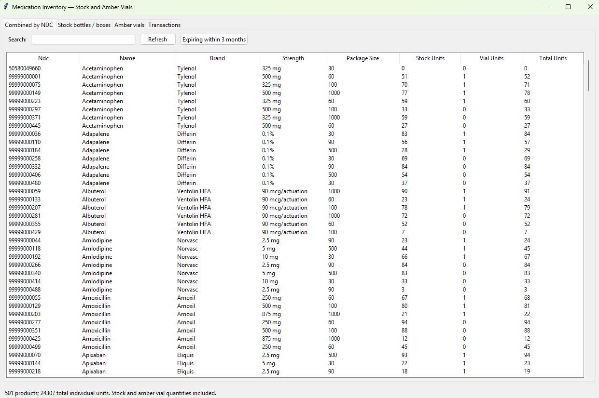
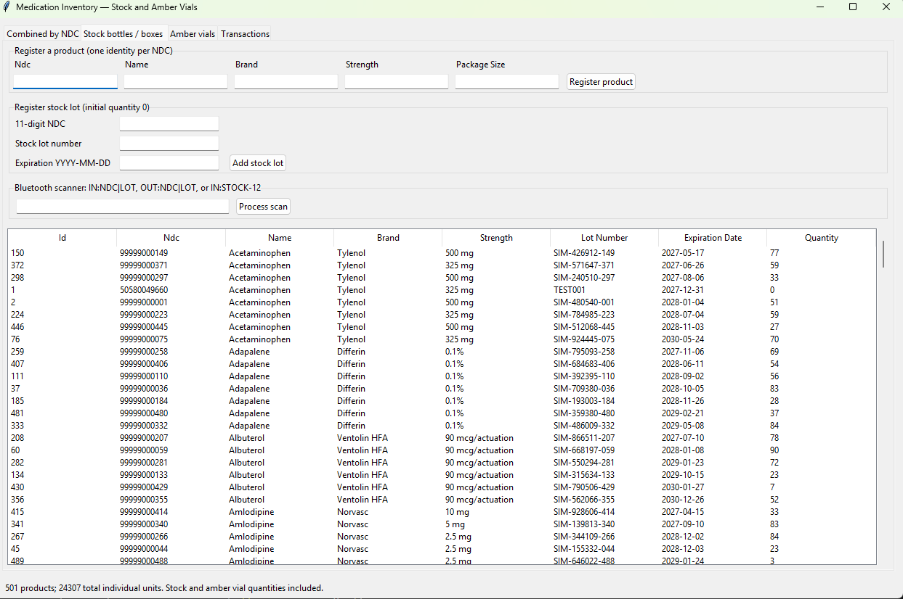
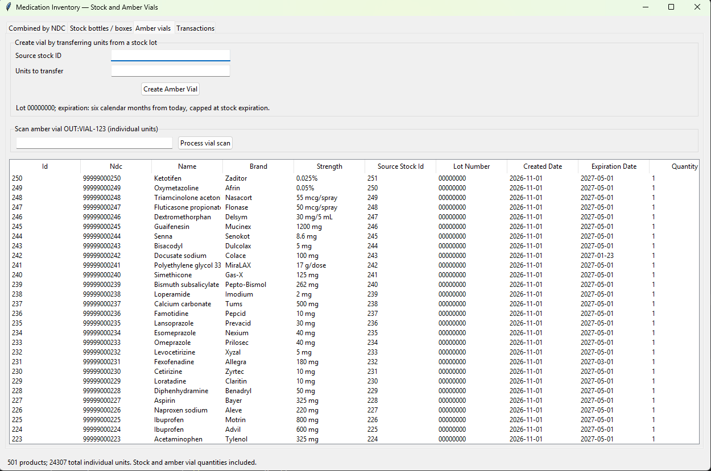
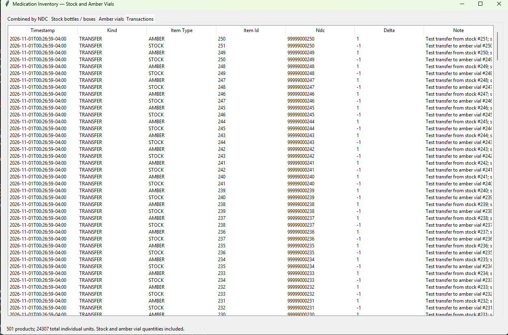
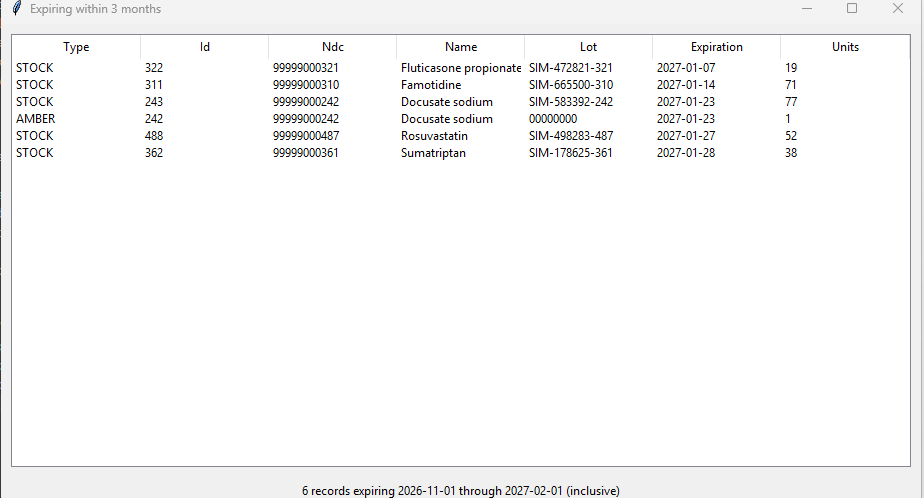

# Medication Inventory

**Python · Tkinter · SQLite · Desktop Inventory Demonstration**

> [!IMPORTANT]
> **100% FABRICATED DEMONSTRATION DATA — NOT REAL PHARMACY DATA**
>
> **Every inventory record, quantity, lot number, expiration date, transaction, stock/vial entry, and sample identifier shown in this project, its database, CSV, and screenshots is fabricated for software demonstration and testing.** None of these records represents actual pharmacy inventory, a real dispensing event, a real patient, or a verified medication record. Medication names and brand names may resemble real products, but their appearance here **does not make any associated NDC, strength, package size, lot, expiration, or quantity authentic or reliable**. Sample identifiers are illustrative and must not be interpreted as validated product identifiers.
>
> **DO NOT USE THIS APPLICATION OR ITS DATA FOR PATIENT CARE, MEDICATION DISPENSING, RECALL DECISIONS, STOCK MANAGEMENT IN A REAL PHARMACY, OR ANY OTHER CLINICAL OR OPERATIONAL PURPOSE.** The application has not been clinically validated, and its sample records must never be treated as authoritative.

Medication Inventory is a desktop application I developed using Python, Tkinter, and SQLite to help organize medication stock, track expiration dates, and maintain a history of inventory changes.

The idea for this project came from my experience working in a pharmacy. Throughout a typical workday, there are situations where I need to check medication quantities, locate specific lot numbers, or identify products that are approaching their expiration dates. These tasks are important, but they can also take time, especially during a busy shift.

I wanted to create an application that could make this information easier to access while allowing me to apply the programming and database skills I have learned throughout my computer science education.

**Note:** This application is an educational portfolio project and is not intended for clinical use, patient care, or medication dispensing. It has not been validated as a pharmacy management system.

## Project Features

The application includes several features designed around common medication inventory tasks.

- **Combined Inventory:** Displays the total number of individual medication units by National Drug Code (NDC), including stock bottles, boxes, and amber vials.
- **Medication Search:** Allows users to search for products by NDC, medication name, or brand.
- **Stock Management:** Tracks individual stock lots, including their lot numbers, expiration dates, and available quantities.
- **Amber Vial Management:** Allows inventory to be transferred from stock bottles or boxes into amber vials while maintaining accurate overall quantities.
- **Expiration Monitoring:** Identifies medications that are scheduled to expire within the next three months.
- **Scanner Input:** Supports inventory adjustments through scanner-style commands.
- **Transaction History:** Records inventory additions, removals, and transfers.
- **Sortable Tables:** Makes it easier to organize and review inventory information.

## How This Project Relates to My Pharmacy Experience

One of the main reasons I wanted to develop this application was to create something that relates directly to my day-to-day responsibilities at work.

Working in a pharmacy has helped me understand how important accurate inventory information can be. Even relatively simple tasks, such as locating a particular medication lot or checking expiration dates, can become time-consuming when there are many products to manage.

This project gave me an opportunity to think about those challenges from a software development perspective.

### Identifying Medications That Are Expiring Soon

One feature I wanted to include was the ability to quickly identify medications that are approaching their expiration dates.

In a pharmacy, checking expiration dates is an important part of maintaining inventory. However, manually reviewing bottles and boxes can take a considerable amount of time, especially when inventory is spread across multiple locations.

The application includes an **Expiring within 3 months** report that displays stock bottles, boxes, and amber vials with available quantities that are approaching their expiration dates.

I believe this feature could be useful in my daily work because it would provide a starting point for identifying products that need attention. Instead of checking every item individually just to determine what might be expiring soon, I could review a list of potentially affected medications and prioritize which products to physically inspect.

It could also help with inventory rotation and identifying products that may need to be reviewed before they expire.

Of course, the information in the application would still need to be verified against the actual medication packaging and the pharmacy's established procedures.

### Tracking and Locating Medication Lot Numbers

Another important part of pharmacy inventory management is keeping track of medication lot numbers.

Different bottles of the same medication can have different lot numbers and expiration dates. Being able to distinguish between them is useful when reviewing inventory, investigating discrepancies, or identifying products affected by a recall.

The application currently displays lot numbers alongside medication information, expiration dates, and quantities in the **Stock bottles / boxes** tab.

One improvement I would like to make is adding the ability to search directly by lot number.

For example, if a pharmacy receives a recall notice identifying a specific medication lot, a lot-number search could help locate matching inventory records much faster than manually reviewing every product.

This could also be useful when checking a shipment or trying to determine which stock lot contains a particular quantity.

Although direct lot-number searching is not yet implemented, it is one of the features I would like to add as the project continues to develop.

### Improving My Daily Workflow

Another goal of this project was to bring several inventory-related tasks into one application.

Instead of keeping track of stock quantities, amber vial transfers, expiration dates, and transaction records separately, the application organizes this information into different tabs.

I think having these features together could make it easier to review inventory changes and identify potential issues.

For example, if I transfer 20 units from a stock bottle into an amber vial, the application automatically subtracts those units from the original stock and adds them to the new vial. The total quantity remains the same, and the transfer is recorded in the transaction history.

This is the type of functionality I wanted to explore because it reflects how inventory moves between different forms of storage in a pharmacy.

Developing this project has also helped me better understand how software can be designed around the needs of the people using it.

Before a system like this could be used in an actual pharmacy, it would require additional testing, security measures, validation, and review of applicable workplace and regulatory requirements.

## Technologies Used

| Technology | Purpose |
|---|---|
| Python 3 | Main programming language |
| Tkinter | Desktop graphical user interface |
| SQLite | Local database management |
| SQL | Storing, retrieving, and updating inventory records |
| Python datetime and calendar | Expiration date calculations |

The application uses Python's standard library and does not require additional third-party Python packages. Tkinter must be available in the Python installation.

## Getting Started

### Requirements

- Python 3
- Tkinter support
- Windows, macOS, or Linux
- The project files downloaded from this repository

### Installation

Clone the repository using Git:

```bash
git clone https://github.com/Brian-Blazejewicz/MedicationInventory.git
```

Navigate to the project directory:

```bash
cd MedicationInventory
```

Run the application:

```bash
python medication_gui.py
```

On Windows, you can also use:

```bash
py medication_gui.py
```

The application opens a desktop window containing the inventory management interface.

If `medications.db` does not already exist in the project directory, the application creates a new SQLite database with the necessary tables. A newly created database will not contain sample inventory records.

The `product_details.csv` file contains supporting medication metadata but is not automatically imported when the application starts.

## Using the Application

### Registering a Medication

Before adding inventory, the medication must be registered in the database.

Under the **Stock bottles / boxes** tab, enter the following information:

- 11-digit National Drug Code (NDC)
- Medication name
- Brand
- Strength
- Package size

Select **Register product** to save the medication information.

### Adding a Stock Lot

After registering a medication, enter its NDC, lot number, and expiration date.

Expiration dates must use the following format:

```text
YYYY-MM-DD
```

Select **Add stock lot** to create the inventory record.

New stock lots begin with a quantity of zero. Inventory can then be added through the scanner input.

### Adding and Removing Inventory

The application accepts scanner-style commands to update medication quantities.

| Command | Function |
|---|---|
| `IN:12345678901\|LOT123` | Add one unit to a specific stock lot |
| `OUT:12345678901\|LOT123` | Remove one unit from a specific stock lot |
| `IN:STOCK-12` | Add one unit to stock record 12 |
| `OUT:STOCK-12` | Remove one unit from stock record 12 |
| `OUT:VIAL-123` | Remove one unit from amber vial 123 |

Each command adjusts the inventory by one individual medication unit.

The example NDC, lot number, and stock IDs are placeholders. Actual commands must match records in the database.

These commands use an application-specific format and do not automatically interpret standard manufacturer barcodes.

### Creating an Amber Vial

The **Amber vials** tab allows units to be transferred from an existing stock lot into a new amber vial.

To create a vial:

1. Enter the source stock ID.
2. Enter the number of units to transfer.
3. Select **Create Amber Vial**.
4. Review the newly generated vial information.

The application checks whether the source stock exists, has enough units, and is not expired.

New amber vials receive the lot number `00000000`.

Their expiration dates are calculated using the earlier of six calendar months from the creation date or the original stock expiration date.

For example, if a stock bottle contains 100 units and 20 are transferred into an amber vial, the updated inventory would be:

| Inventory location | Quantity |
|---|---:|
| Original stock | 80 |
| Amber vial | 20 |
| Combined inventory | 100 |

This allows the application to track where the medication units are stored without counting the same units twice.

## Application Interface

The interface is divided into four main tabs.

### Combined by NDC

This tab displays medication information and the combined quantities available across stock bottles, boxes, and amber vials.

Users can search by NDC, medication name, or brand. The tab also includes the **Expiring within 3 months** report.

### Stock Bottles / Boxes

This tab is used to register medications, create stock lots, process inventory scans, and review individual stock records.

Each stock record includes its lot number, expiration date, and quantity.

### Amber Vials

This tab is used to transfer inventory from stock lots into amber vials and review the resulting vial records.

It displays the source stock ID, vial lot number, creation date, expiration date, and remaining quantity.

### Transactions

This tab displays the 500 most recent inventory movements, including additions, removals, and stock-to-vial transfers.

Having a transaction history makes it easier to review how inventory quantities have changed over time.

## Application Screenshots

The images below are referenced using relative paths so GitHub displays them automatically when the PNG files are stored in the repository’s `screenshots/` folder.

**All information visible in the screenshots below is fabricated demonstration data.** The names may be recognizable, but the NDCs, lot numbers, expiration dates, quantities, vial entries, and transaction history shown are not actual pharmacy records and must not be relied upon for real-world decisions.

### Combined Medication Inventory

The combined view shows illustrative stock and amber-vial quantities by NDC, with a search field and a shortcut to the expiration report.



### Stock Bottles and Boxes

The stock screen demonstrates product registration, lot tracking, and scanner-style inventory adjustments using fictional records.



### Amber Vial Management

This screen illustrates transferring units from stock into amber vials, including automatically assigned demonstration vial details.



### Transaction History

The transaction view displays simulated inventory movements and stock-to-vial transfers. **These are test transactions, not actual pharmacy activity.**



### Expiration Monitoring

The three-month report highlights example items with approaching expiration dates. **The dates and inventory entries are invented for testing; this is not a real expiration or recall report.**



## Database Structure

The application uses SQLite to store inventory information locally.

The database includes four main tables.

| Table | Description |
|---|---|
| `products` | Stores medication information associated with each NDC |
| `stock_lots` | Tracks individual stock lots, quantities, and expiration dates |
| `amber_vials` | Tracks medication units transferred into amber vials |
| `movements` | Records inventory transactions and transfers |

An additional SQL view called `inventory_totals` calculates the combined quantity for each medication.

I separated the database into these tables to keep the information organized and make it easier to manage the relationships between products, stock lots, and amber vials.

## Project Files

| File | Description |
|---|---|
| `medication_gui.py` | Contains the Tkinter interface |
| `medication_inventory.py` | Handles database operations and inventory logic |
| `medications.db` | SQLite database containing inventory records, when present |
| `product_details.csv` | Supporting medication metadata |
| `README.md` | Project documentation |

## Future Improvements

There are several features I would like to add as I continue developing the application.

- **Lot-number search:** Allow users to locate inventory directly by entering a specific lot number.
- **Advanced filtering:** Add more options for sorting and filtering medications by expiration date, quantity, or inventory location.
- **Improved reporting:** Create additional reports for low inventory, upcoming expirations, and inventory activity.
- **Barcode integration:** Expand scanner support to interpret standard barcode formats.
- **Interface improvements:** Continue refining the layout and usability based on common pharmacy workflows.

These additions would help make the application more useful as a demonstration of inventory management software.

## What I Learned

Working on this project allowed me to combine my pharmacy experience with the programming skills I have developed while studying computer science.

I gained more experience building graphical interfaces with Tkinter, working with SQLite databases, writing SQL queries, validating user input, and organizing code into separate components.

One of the more interesting parts of the project was figuring out how to transfer inventory between stock bottles and amber vials without changing the overall medication quantity. I also wanted to make sure those transfers could be reviewed through a transaction history.

More importantly, this project helped me think about how software can address problems that people encounter in their everyday jobs.

I plan to continue improving the application as I learn more about software development, database management, and application design.

## Author

**Brian Blazejewicz**

Computer Science Student  
Southern New Hampshire University

GitHub: [Brian-Blazejewicz](https://github.com/Brian-Blazejewicz)

> [!WARNING]
> **FABRICATED DATA ONLY.** All data in the SQLite database, CSV, and screenshots is invented for demonstration. No record represents real pharmacy inventory or a verified medication record. Do not use this software or its data for actual pharmacy operations.

*This project was created solely for educational and portfolio purposes. It is not intended to replace professional pharmacy inventory systems or established medication-handling procedures.*
